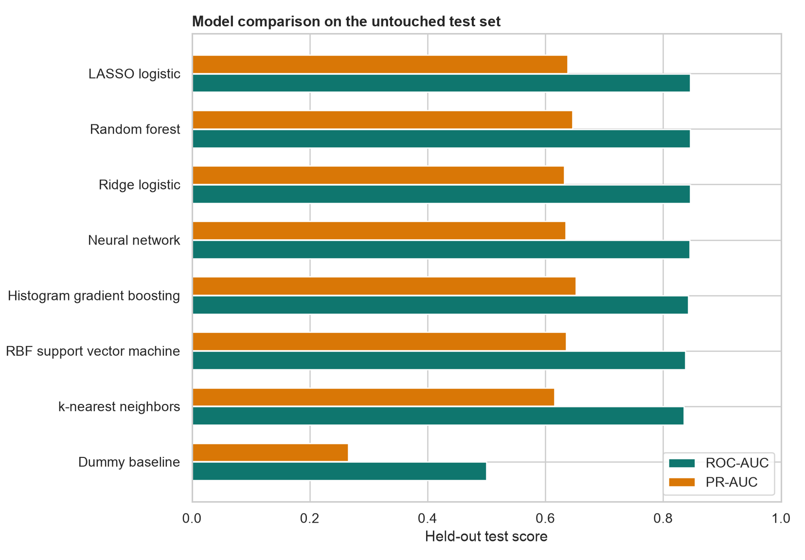
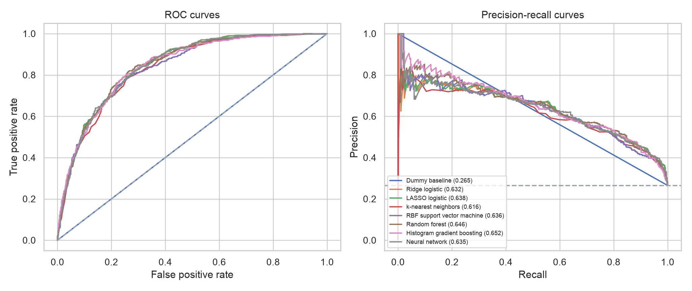
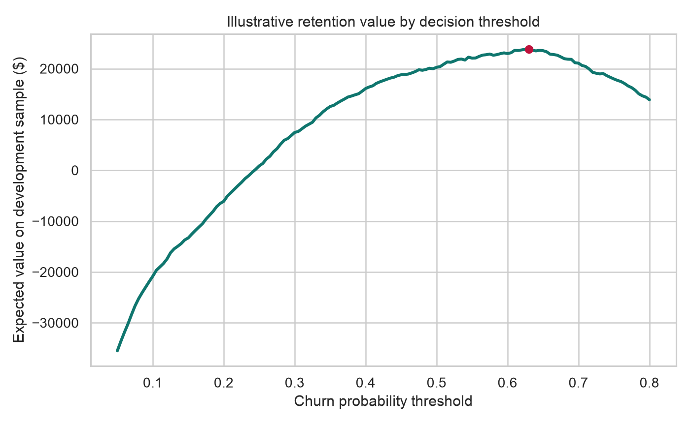
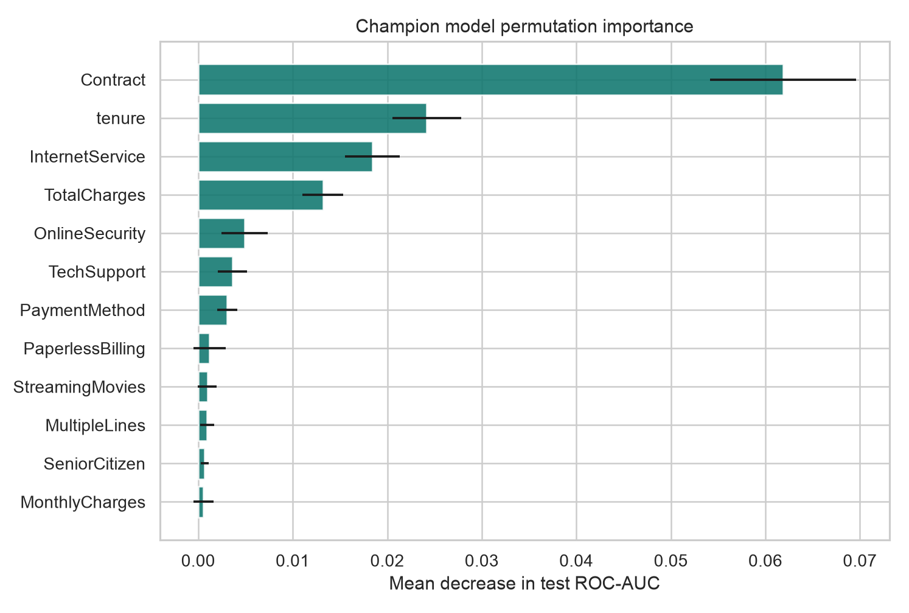
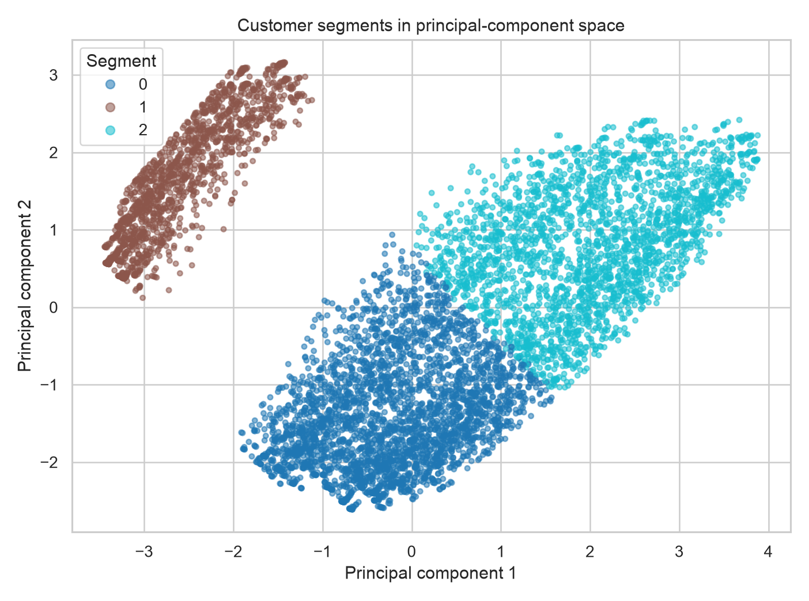
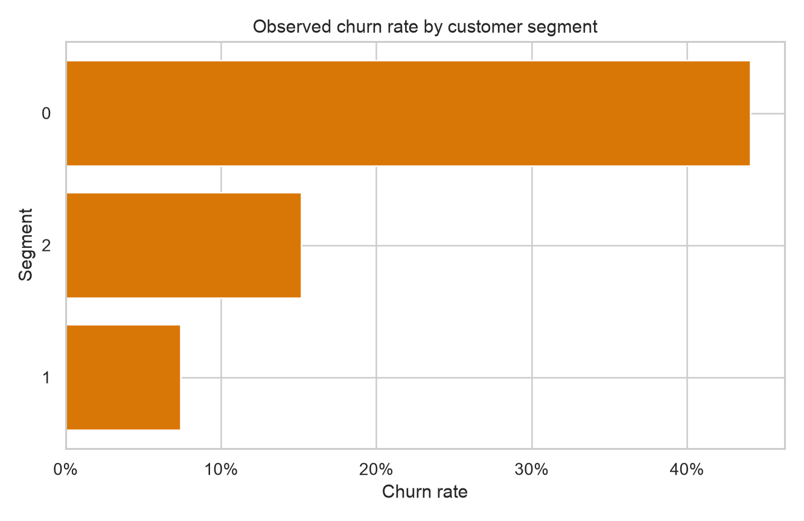

# Subscription Churn Product Report

## Executive Summary

This project analyzes **7,043 subscription customers**, of whom **26.5%** churned. Eight statistical and machine-learning approaches were compared using stratified five-fold cross-validation. **Random forest** was selected before the test set was evaluated.

On the untouched test set, the selected model achieved **0.846 ROC-AUC** (bootstrap 95% CI **0.827-0.865**) and **0.646 PR-AUC** (95% CI **0.600-0.695**). The fitted settings were `{"classifier__max_depth": null, "classifier__min_samples_leaf": 12}`.

## Learning Design

The workflow follows the model-selection ideas in UBC STAT 406: preprocessing is fit inside each fold; model choice is based on cross-validation; an untouched test set estimates generalization; and bootstrap resampling quantifies uncertainty. The comparison covers regularized linear models, kNN, an RBF kernel machine, a random forest, gradient boosting, and a neural network.

| Model | CV ROC-AUC | CV PR-AUC | CV Brier |
|---|---:|---:|---:|
| Random forest | 0.846 | 0.664 | 0.156 |
| Ridge logistic | 0.844 | 0.658 | 0.166 |
| LASSO logistic | 0.844 | 0.659 | 0.166 |
| Neural network | 0.842 | 0.659 | 0.136 |
| Histogram gradient boosting | 0.842 | 0.665 | 0.158 |
| RBF support vector machine | 0.839 | 0.657 | 0.141 |
| k-nearest neighbors | 0.835 | 0.632 | 0.141 |
| Dummy baseline | 0.500 | 0.265 | 0.195 |

## Held-Out Performance

The 0.50 threshold is shown here for a common operating-point comparison. ROC-AUC and PR-AUC evaluate ranking across thresholds; the Brier score evaluates probability error, where lower is better.

| Model | ROC-AUC | PR-AUC | Brier | Recall | Precision |
|---|---:|---:|---:|---:|---:|
| LASSO logistic | 0.846 | 0.638 | 0.166 | 0.797 | 0.519 |
| Random forest | 0.846 | 0.646 | 0.156 | 0.779 | 0.540 |
| Ridge logistic | 0.846 | 0.632 | 0.166 | 0.794 | 0.517 |
| Neural network | 0.845 | 0.635 | 0.137 | 0.493 | 0.659 |
| Histogram gradient boosting | 0.843 | 0.652 | 0.159 | 0.792 | 0.532 |
| RBF support vector machine | 0.838 | 0.636 | 0.142 | 0.617 | 0.601 |
| k-nearest neighbors | 0.835 | 0.616 | 0.142 | 0.565 | 0.592 |
| Dummy baseline | 0.500 | 0.265 | 0.195 | 0.000 | 0.000 |

## Product Decision Threshold

A threshold should reflect the economics of a retention action rather than maximize accuracy. The illustrative scenario assumes a **$30** contact/offer cost, a **25%** save rate among customers who would churn, and **$300** in retained contribution per successful save. Under those assumptions, the development-set rule selected a threshold of **0.630**. Applied once to the test set, it targets **455** customers and reaches **281** observed churners.

This dollar estimate is a scenario analysis, not realized revenue. Product owners should replace the assumptions with experimental offer uptake, contribution margin, and treatment-effect estimates.

## Churn Drivers

Permutation importance on the test sample identifies the variables most useful to the selected model. The leading fields are **Contract, tenure, InternetService, TotalCharges, OnlineSecurity**.

| Feature | Mean ROC-AUC decrease |
|---|---:|
| Contract | 0.0619 |
| tenure | 0.0242 |
| InternetService | 0.0184 |
| TotalCharges | 0.0132 |
| OnlineSecurity | 0.0049 |
| TechSupport | 0.0036 |
| PaymentMethod | 0.0031 |
| PaperlessBilling | 0.0012 |
| StreamingMovies | 0.0010 |
| MultipleLines | 0.0009 |

These are predictive associations. Contract changes, support bundles, and pricing interventions should be tested experimentally before being treated as causes of churn.

## Customer Segments

PCA retained 90% of the encoded feature variance before K-means clustering. The number of clusters was selected from 2-6 using silhouette score.

| Segment | Customers | Churn rate | Median tenure | Median monthly charge | Month-to-month | Tech support |
|---:|---:|---:|---:|---:|---:|---:|
| 0 | 3,179 | 44.1% | 12 | $70.40 | 87.1% | 22.1% |
| 2 | 2,338 | 15.2% | 60 | $92.78 | 24.9% | 57.3% |
| 1 | 1,526 | 7.4% | 25 | $20.15 | 34.3% | 0.0% |

Segments with high churn, short tenure, month-to-month contracts, and limited support adoption are candidates for onboarding and service interventions. Segments should be validated for stability and business usefulness before activation.

## Product Recommendations

1. Score customers regularly and send the top risk tier to a controlled retention experiment.
2. Test early-tenure onboarding, annual-contract migration, and technical-support bundles as separate treatments.
3. Track incremental retention and contribution margin, not model accuracy alone.
4. Monitor calibration, segment mix, and feature distributions after deployment.
5. Exclude protected or sensitive attributes from offer eligibility decisions unless legal and fairness review supports their use.

## Limitations

- The IBM sample represents a fictional telecommunications company and has no event timestamp, so random-split performance may overstate future-period performance.
- Churn prediction estimates who is likely to leave, not who will respond to an intervention; uplift modeling requires treatment data.
- The value threshold depends on explicit assumptions and must be recalibrated for a real product.
- Customer clusters summarize similarity but do not establish stable behavioral personas.
