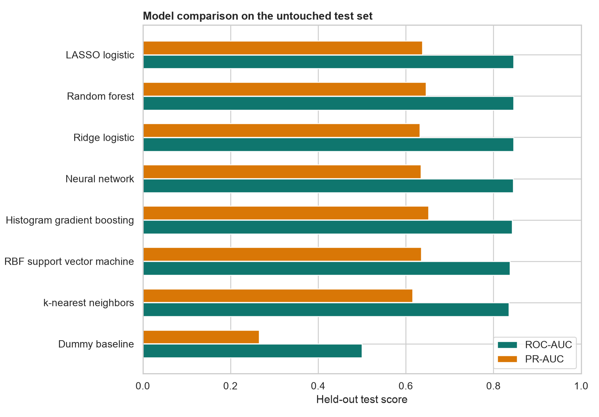

# Subscription Churn and Customer Segmentation

[](train.py)
[](results/)
[](PRODUCT_REPORT.md)

An end-to-end machine-learning project for a subscription product team. It predicts customer churn, compares statistical and algorithmic learning methods, quantifies uncertainty, chooses a retention threshold from explicit economics, and creates customer segments for product planning.

The analysis is inspired by public Kaggle churn projects, but uses the IBM sample dataset from the [IBM watsonx-ai-samples repository](https://github.com/IBM/watsonx-ai-samples/blob/master/cpd4.5/data/customer_churn/WA_FnUseC_TelcoCustomerChurn.csv). Each row represents one customer and includes services, contract, billing, tenure, and churn status.

## Results at a Glance

- **7,043 customers** with a **26.5% churn rate**
- **8 candidate models** compared with stratified five-fold cross-validation
- **Random forest** selected from cross-validation, with **0.846 test ROC-AUC** and **0.646 test PR-AUC**
- Bootstrap 95% intervals: **0.827-0.865 ROC-AUC** and **0.600-0.695 PR-AUC**
- A value-based threshold of **0.63** reached **281 of 467** observed test-set churners while targeting 455 customers
- Three data-driven customer segments, with observed churn ranging from **7.4% to 44.1%**



## Methods

This project applies topics from the [UBC STAT 406 schedule](https://ubc-stat.github.io/stat-406/schedule/):

- Stratified train-test splitting and five-fold cross-validation
- Ridge and LASSO logistic regression
- k-nearest neighbors and an RBF support vector machine
- Random forest and histogram gradient boosting
- Multilayer perceptron neural network
- Bootstrap confidence intervals
- PCA and K-means clustering with silhouette-based model selection
- Permutation importance and probability-quality evaluation
- Business-value threshold analysis

## Outputs

- [Product report](PRODUCT_REPORT.md): model evidence, segmentation, economics, recommendations, and limitations
- `results/`: cross-validation, test metrics, bootstrap intervals, feature importance, customer scores, and segment profiles
- `figures/`: model comparison, ROC/PR curves, threshold economics, importance, and customer segments
- `train.py`: complete reproducible training, evaluation, segmentation, and reporting workflow
- `test_train.py`: automated data-contract and decision-threshold checks

## Reproduce

```bash
python3 -m venv .venv
source .venv/bin/activate
pip install -r requirements.txt
python train.py
python -m unittest test_train.py
```

All random operations use seed `42`. Model selection uses only the development sample; the test set is evaluated after the champion and threshold rule are chosen.

## Responsible Use

This is an educational product-analytics project using fictional company data. Churn risk should prioritize experimentation, not automatic denial of service or differential pricing. A real deployment would require temporal validation, fairness review, monitoring, and treatment-effect measurement.
